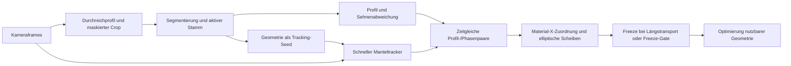

# Kritische Machbarkeitsprüfung der Stammausrichtung – 16.09.2026

**Verbindliches Ziel nach Präzisierung des Betreibers:** Der bestehende Schritt **Optimierung nutzbarer Geometrie bleibt erhalten**. `VORSCHNITT_KRITISCH` maximiert den symmetrisch nutzbaren Bereich oben/unten, `NACHSCHNITT_KRITISCH` links/rechts, jeweils bezogen auf die unveränderte spätere Zentrierachse. Benötigt wird ein verlässliches Scheibenmodell einschließlich Form und Mittelpunktversatz. Die ursprüngliche Interpretation als reine Bogenorientierungsaufgabe und die daraus abgeleitete Empfehlung eines einfacheren Bogenmodells sind damit korrigiert. Ein rotierender Referenzkörper steht derzeit nicht zur Verfügung und ist keine Voraussetzung für den nächsten Entwicklungsschritt.

**Urteil:** Die natürliche Rollbewegung als Messbewegung zu verwenden ist grundsätzlich plausibel. Die vorhandene Pipeline liefert aber noch keinen belastbaren Nachweis der räumlichen Genauigkeit des Scheibenmodells. Es fehlen nicht nur schnellere Verarbeitung und günstigere Schwellenwerte. Mehrere Annahmen des Beobachtungsmodells passen nicht ohne Weiteres zum beschriebenen schrägen Blick und zum Überrollen der Schwelle. Auch bei perfekten Bildzuordnungen können aktuell fachlich falsche, gut bewertete Modelle entstehen.

Priorität haben daher die räumliche Anlagen-/Kamerakalibrierung, die Trennung von Stammbewegung und Stammform und die Bindung der rekonstruierten Scheiben an die spätere Zentrierachse. Runtime, Scheibenvertrag und geometrische Zielfunktion bleiben die Grundlage. Eine weitere reine FPS-/Recovery-Optimierungsrunde wäre keine ausreichende Antwort auf die Machbarkeitsfrage. Ein Neukauf der Kamera ist aus den bisherigen Daten ebenfalls noch nicht begründet.

**Untersuchungsgrundlage und Grenzen**

Gelesen wurden die Analysen und Umsetzungsberichte vom 14./15.09., die Integrations-/Versuchsdokumentation und die tatsächlich beteiligten Module für Prozesskoordinaten, Stammwahl, Mantelphase, Krümmung, Scheibenfit, Optimierer und Freeze. Der Checkout enthält bereits zahlreiche Änderungen anderer Arbeiten. Dieser Auftrag verändert keinen Produktionscode und keine Serverkonfiguration.

Zusätzlich erfolgten ausschließlich lesende HTTPS-Abfragen des angebotenen Servers: Kanal, Status, Definition und Liveansicht. Aktiv ist weiterhin `Stammeindrehung inkl. Modell`, Kanal `chn_8db0e33874024d15b65f370efbbcc12c`, Version **v41 / `plv_9de3adfeb71440cdb13804d68240b65c`**. Die abgerufene vollständige neueste Version hat genau diese ID; sie wurde nicht mit einem anderen Entwurf verwechselt. Ein Release-/Python-Dateihash des Servers wurde nicht geprüft. Codegegenproben beziehen sich deshalb auf den lokalen Arbeitsstand.

Die Pollstichprobe umfasst Quellzeitstempel **16.09.2026, 08:20:54,869–08:22:24,404 MESZ**: 297 Antworten, 239 unterschiedliche Zustände mit Frame, zusätzlich einen Zustand ohne Frame. Dedupliziert wurde nach Sequenz und Quellzeitstempel. Ein einzelnes Livebild von 08:22:00,879 MESZ wurde zusätzlich betrachtet. Dies ist kein vollständiges Video und erlaubt keine quantitative Aussage zur tatsächlichen Rollgeschwindigkeit oder Bewegungsunschärfe während des Transfers. Die beiden vom Betreiber bereitgestellten Bilder und dessen Prozessbeschreibung bilden die räumliche Einordnung.

**1. Was grundsätzlich funktionieren kann**

Für einen näherungsweise starren Stamm ändern sich die projizierten Scheibenbreiten und Scheibenmittelpunkte mit der Eigenrotation. Bei bekannter Kameraprojektion und ausreichend bestimmter Bewegung können mehrere unterschiedliche Ansichten die Schätzung von Ellipsenachsen, Ellipsenwinkel und Mittelpunktversatz ermöglichen. Eine vollständige 360°-Drehung ist für ein elliptisches Näherungsmodell nicht grundsätzlich notwendig. Ein absolut bekannter Winkel beim Start ist ebenfalls nicht zwingend: Ein konsistenter relativer Ursprung reicht, wenn Modell, Endlage und Maschinenachsen räumlich zusammenpassen. Das beweist noch nicht, dass die reale kurze Rollsequenz alle benötigten Größen eindeutig bestimmt.

Die Einschränkungen sind wesentlich:

- Derselbe Materialabschnitt muss in den verschiedenen Stellungen verglichen werden.
- Der Winkel muss aus einer validierten visuellen Rotationsspur stammen; zurückgelegter Querweg ist über der Schwelle und bei möglichem Schlupf keine Winkelreferenz.
- Höhenbewegung, Quertranslation und Änderung der Achsrichtung dürfen nicht als Eigenrotation oder Form interpretiert werden.
- Genügend verschiedene Winkel müssen vor dem Entscheidungszeitpunkt vorliegen. Viele ähnliche Bilder ersetzen keine Winkelabdeckung.
- Bei fast kreisförmiger Scheibe ist deren Ellipsenwinkel schlecht bestimmt, ohne dass dadurch zwingend die gesamte Scheibe unbrauchbar wird. Bei einem geraden ovalen Stamm kann die geometrische Optimierung sehr wohl sinnvoll sein.
- Ein Scheibenellipsenmodell beschreibt nicht jede Rindenunregelmäßigkeit und keine beliebige Querschnittsform exakt. Seine Genauigkeit muss anhand der resultierenden Geometrie und der daraus abgeleiteten Drehentscheidung bewertet werden.

Die vorhandene symmetrische Geometriezielfunktion ist 180°-periodisch. Daraus folgt keine Erlaubnis, die gerichtete Rotationsspur oder die Mittelpunktbewegung vorzeitig modulo 180° zusammenzulegen. Die signierte Korrektur muss weiterhin den versionierten Betrachtungsstandpunkt verwenden.

**2. Der tatsächlich aktive Ablauf**



Die Trennung zwischen schneller Phase und langsamerer Segmentierung ist sinnvoll. Ebenso wichtig und richtig sind die exakte Framepaarung, die Trennung verschiedener Phasengenerationen und das Unterdrücken ungültiger Ergebnisse. Diese Infrastruktur sollte erhalten bleiben.

Der letzte Schritt entspricht dem präzisierten Betreiberziel: `VORSCHNITT_KRITISCH → VERTICAL_Z` maximiert die kleinste nutzbare symmetrische Geometrie entlang Z, `NACHSCHNITT_KRITISCH → HORIZONTAL_Y` entsprechend entlang Y. Dabei wirken Ovalität und Scheibenversätze mit. Maßgeblich ist die engste relevante Scheibe, nicht das integral größte Stammvolumen. Diese Zielfunktion und die Prioritätslogik werden nicht durch eine reine Bogenorientierung ersetzt.

Der alternative `stem_curvature_phase_solver` ist kein Ersatz für dieses Ziel. Das Gegenbeispiel in Abschnitt 4 erläutert weiterhin eine Projektionsgrenze, begründet aber keinen Wechsel des Optimierers.

**3. Die Kalibrierung ist derzeit keine vollständige räumliche Messkalibrierung**

Im aktiven Graphen und im Liveframe stehen:

- Intrinsik: `IDENTITY_PASSTHROUGH`, null Verzeichnungskoeffizienten, **0 akzeptierte Kalibrierbeobachtungen**; Live-Metadatum `intrinsic_calibrated=false`.
- Kanonische Ansicht: `POLYGON_MASKED_CROP`, `preserves_source_perspective=true`. Das sichtbare gedrehte Polygon ist eine maskierte Bildansicht, keine metrisch entzerrte Draufsicht auf den Stamm.
- Prozesskoordinaten: vier Referenzpunkte für eine XY-Homographie auf `z=0`.
- Der eingezeichnete Z-Pfeil hat `z_reference_length_mm=null`. Er definiert eine Richtung, aber keine gemessene Höhen-/Tiefenskala oder vollständige Kamerapose.

**Zusätzlicher Codebefund nach der Zielpräzisierung:** Der vorhandene Koordinatenassistent bietet bereits `Optional known Z reference length [mm]` an. Die Oberfläche bezeichnet das Feld ausdrücklich als `Documentation only in V1; Z is not reconstructed from the image.` Das Backend speichert `coordinate_frame_definition`, berechnet die Projektion jedoch ausschließlich aus den XY-Referenzpunkten mit `findHomography`. Auch eine eingetragene Z-Länge würde im aktuellen Pfad noch keine räumliche Rekonstruktion bewirken. Es fehlt somit nicht jede Kalibrierungsmöglichkeit: Intrinsik- und XY-Kalibrierpfade existieren, aber die räumliche Verknüpfung für diesen Messprozess fehlt. Belege: `runtime-pipeline-designer-page.tsx:6845`, `stem_process_coordinates.py:34` und `:175`.

Die Prozesshomographie ist als Ebenenkalibrierung brauchbar. Ihr sehr kleiner Rückprojektionsfehler von etwa 0,000012 Pixel ist bei vier angepassten Punkten aber keine unabhängige Messgenauigkeitsprüfung. Er belegt insbesondere nicht die Genauigkeit oberhalb dieser Ebene. Wie groß die unberücksichtigte Objektivverzeichnung ist, bleibt offen; das Durchreichprofil beweist weder große noch vernachlässigbare Verzeichnung.

Eine Homographie für eine Referenzebene rekonstruiert die Höhe eines darauf liegenden dreidimensionalen Stamms nicht. Das zugrunde liegende Ebenen- und Kameramodell ist in den primären OpenCV-Dokumentationen zu [Homographien](https://docs.opencv.org/3.4.8/d9/dab/tutorial_homography.html) und [Kameraprojektion](https://docs.opencv.org/4.12.0/d9/d0c/group__calib3d.html) beschrieben.

Für diesen Aufbau folgt daraus: Beim Anheben können sich zurückgerechnete X-/Y-Position, Maßstab und Breite ändern, obwohl die entsprechende physische XY-Bewegung nicht stattfindet. Das betrifft nicht nur Millimeterwerte, sondern auch Materialzuordnung und Bewegungsklassifikation. Die Förderkontur ist eine hilfreiche zusätzliche Randbedingung; die tatsächliche Bahn der Stammachse hängt außerdem von Durchmesser, Form und Kontaktstellen ab.

Wichtig ist die Abgrenzung: Eine ideal gerade 3D-Linie bleibt unter idealer perspektivischer Projektion gerade. Reine Translation macht sie nicht automatisch krumm. Problematisch sind die Interpretation absoluter Profilwerte, veränderliche Perspektive, Silhouetten und wechselnde Materialabschnitte.

**4. Ergänzendes Projektionsbeispiel, keine alternative Zielfunktion**

Lokal und vereinfacht kann die beobachtete Querabweichung so aussehen:

```text
q = a · Bogen_Y + b · Bogen_Z
```

Die Faktoren hängen von Blickrichtung und Lage ab. Eine auf den Boden zurückgerechnete Bildkoordinate enthält bei einem erhöhten Objekt weiterhin einen Höhenanteil. Über der Schwelle können sich diese Faktoren verändern. Ein fester Projektionswinkel wäre daher nur eine nachzuweisende Näherung.

Zur Veranschaulichung wurde der vorhandene Minimumsolver mit **synthetischen**, fehlerfreien Beobachtungen `q = 20 · (cos(theta) − 0,5 · sin(theta))` über 180° aufgerufen. Der Bogen ist bei theta=0 horizontal und bei theta=90° vertikal. Der Solver findet korrekt das Minimum seiner Eingabe bei **63,435°**, Status `SOLVED`, Konfidenz praktisch 1. Würde man diese Phase als „vertikal“ ausgeben, wäre die physische Zielinterpretation um **26,565°** falsch.

Das ist keine gemessene Abweichung dieser Anlage und kein Fehler der harmonischen Ausgleichsrechnung. Es zeigt, warum selbst perfekte Daten und ein perfekter Fit die fehlende Zuordnung zwischen Projektionsminimum und Maschinen-Y/Z nicht ersetzen. Ein Wechsel vom Scheibenoptimierer zum Minimumsolver allein löst das Problem deshalb nicht.

**5. Der Scheibenfit verwechselt zulässige Transportbewegung mit Formversatz**

`nodes/stem_slice_model.py::_append_profile_observations()` registriert die Material-X-Verschiebung, übernimmt aber das interpolierte absolute `y_center_mm`. Eine zeitabhängige gemeinsame Querbewegung wird dort nicht entfernt. `fit_stem_slice()` passt anschließend an:

```text
y(theta) = konstanter_offset + cy · cos(theta) − cz · sin(theta)
```

Der konstante Offset kann einen statischen Bild-/Positionsversatz aufnehmen, nicht den Quertransport während des Rollens. Ein Transportanteil mit ähnlichem Verlauf wird als `cy/cz` interpretiert.

Der bereits am 14.09. beschriebene Gegenfall wurde im heutigen Code erneut ausgeführt: gerader runder Körper, konstante Breite 300 mm, 13 Beobachtungen über 120°, reine gemeinsame Bewegung `y = 300 + 40·sin(theta)`. Ergebnis: **gültige Scheibe mit `cz = −40 mm`, Qualität 0,935, praktisch null Residuum**.

Wenn diese Bewegung an allen Stationen gleich ist, entsteht dadurch nicht notwendigerweise eine gebogene Mittellinie. Es entstehen aber gegenüber der angenommenen Drehachse versetzte Scheiben, die der Optimierer als Geometrie behandelt. Seine Zielfunktion schneidet die Ellipsen mit einer Achse durch den Maschinenursprung. Eine hohe Modellqualität schützt nicht gegen den falschen Achsbezug.

Die vorgelagerte Krümmungsstufe berechnet bereits eine robuste Sehne und Residuen. Der Builder verwendet für seinen Zentrumfit jedoch `y_center_mm`, nicht diese Residuen. Für das bestätigte Optimierungsziel wäre ein bloßer Austausch durch Residuen ebenfalls falsch: Benötigte Scheibenversätze gegenüber der späteren Zentrierachse könnten dabei entfernt werden. Erforderlich ist eine gemeinsame Schätzung von Starrkörperbewegung und stammfester Form mit explizitem Achsbezug. Ein frei gewählter Profilmittelwert oder ein unabhängig für jeden Frame neu gesetzter Nullpunkt ersetzt diese Referenz nicht.

**6. Viele Features sind hilfreich, aber keine Winkelvalidierung**

Der aktive V2-Schätzer arbeitet näherungsweise mit einem kreisförmigen Querschnitt und kleinen Winkeländerungen pro Bildpaar. Er regressiert Translation und Rotation gemeinsam über die Basis `[1, sqrt(0,25 − u²)]`. Unterschiedliche Featurepositionen über die Breite sind nötig, damit beide Anteile unterscheidbar werden. Der Code prüft die Spannweite von `u`, jedoch nicht Rang oder Kondition dieser Regressionsmatrix.

Erneut reproduziert: 24 fehlerfreie Matches auf zwei symmetrischen Streifen bei `u=±0,35`. Die Streifen sind weit auseinander, haben aber dieselbe Rotationsbasis. Matrixrang: **1 statt 2**. Eine eingespeiste linearisierte Rohrotation von 0,2 wird als **0,0226** geschätzt; dennoch `valid=true`, Konfidenz **1,0**. Eine reine gemeinsame Restverschiebung bei unveränderter Achsreferenz erzeugt ebenfalls eine nichtnullige Rohrotation. Die Zahlen sind synthetische Rohphaseneinheiten, keine am Server gemessenen Gradfehler.

Damit ist die Aussage „wir finden viele Features“ ein gutes Argument gegen ein vorschnelles Verwerfen der Kamera, aber noch kein Beleg für eine identifizierbare Rotation. Benötigt werden stabile Korrespondenzen, informative Verteilung über den Mantel, ausreichende Schärfe während der schnellen Bewegung und Konsistenz zum Bewegungsmodell. Optical Flow liefert zunächst Bildpunktbewegungen, keine fertige physische Rotation; siehe [OpenCV Optical Flow](https://docs.opencv.org/4.x/d4/dee/tutorial_optical_flow.html).

Die gespeicherte Gradkalibrierung verwendet vier Werte 0°, 58°, 85°, 140° aus einer kurzen Sequenz, Steigung −31,926 Grad/Rohphase. Ihre Fitfehler sind Fehler auf denselben Kalibrierpunkten, keine unabhängige Validierung. Die Provenienz bezeichnet einen markierten Teststamm; ein Referenzartefakt ist nicht hinterlegt. Wie diese Winkel tatsächlich bestimmt wurden, wurde beim Betreiber angefragt. Aus dem gespeicherten Status `valid` lässt sich die physische Richtigkeit nicht zusätzlich ableiten. Ein globaler Faktor kann insbesondere keinen beliebigen Wechsel von Perspektive, Form und Bewegungsregime kompensieren.

**7. Stammwahl, Materialabschnitt und Endlage brauchen getrennte Nachweise**

Die geschilderte Situation enthält gleichzeitig den auslaufenden Stamm links und den nächsten Messkandidaten rechts. Bei einer neuen Akquisition bevorzugt die aktive Konfiguration den Längsförderer (`prefer_longitudinal_on_acquisition=true`). Das verhindert einen Identitätswechsel auf einen Nachfolger, kann aber die frühe Vorbereitung des wartenden Stamms verzögern. Es ist ein anhand vollständiger Zyklen zu prüfender Zielkonflikt, kein aus dem Standbild bewiesener regelmäßiger Fehlgriff. Bereits verfolgte Stämme werden vorher auf Kontinuität geprüft.

Das zusätzlich abgerufene Livebild zeigt einen am rechten Maskenrand abgeschnittenen wartenden Stamm. In diesem Zustand ist keine vollständige Silhouette verfügbar. Das schließt Manteltracking nicht aus, begrenzt aber belastbare Breiten-/Mittellinienmessungen. Auch die Sichtbarkeit des Gesamtbogens ist nicht nachgewiesen. Ein Teilabschnitt kann einen anderen Bogenverlauf als der restliche Stamm haben.

Der bestehende Materialabgleich korrigiert eine gemeinsame X-Translation. Die perspektivische Wirkung von Hub und Achsneigung kann darüber hinaus eine Skalierung oder nichtuniforme Zuordnungsänderung verursachen. Ein fester Prozess-X-Wert bezeichnet dann nicht zwingend dieselbe reale Stammscheibe. Außerdem kann die Silhouette einer schräg betrachteten Oberfläche über benachbarte Längsabschnitte entstehen; der Mittelpunkt der sichtbaren Kontur ist nicht allgemein ein direkt gemessener 3D-Querschnittsmittelpunkt.

Die Erkennung des Längstransports fordert aktuell mindestens drei bestätigende X-Beobachtungen, einen räumlichen Eintritt und 120 mm Vorwärtsfortschritt. Das ist eine sinnvolle Absicherung gegen Fehlklassifikation, bedeutet aber eine unvermeidliche Erkennungsverzögerung gegenüber dem ersten mechanischen Bewegungsbeginn. Bei wenigen Pipelinebildern pro Sekunde ist diese relevant. Freeze- und Decision-Gate liegen zusätzlich auf derselben oberen Bildkante, `decision_margin_mm=0`.

Das Ziel sollte deshalb lauten: Bogenmodell während des Rollens vorbereiten, aktuelle Rotationslage bis zum Entscheidungsframe verfolgen, rechtzeitig zum bestätigten Transportbeginn ausgeben und die Reserve zum ersten Vorzentrierungs-Walzenpaar nachweisen. Ein nachträglich erkanntes Ereignis kann nicht rückwirkend eine rechtzeitige Ausgabe garantieren.

**Neu reproduzierte Lücke am Freeze:** Nach einem gültigen Beobachtungssatz kann der Builder bei Beginn des Längstransports ein Modell aus `last_phase_deg` einfrieren, obwohl die aktuelle Phase `LOST`, unverriegelt und ungültig ist. Dafür reicht eine unveränderte Identitäts-/Generationsbindung. Der Optimierer bekommt das eingefrorene Modell, aber keine separate aktuelle Phasenfreigabe.

Lokaler Versuch mit dem tatsächlichen Handler, vorhandenen Testfixtures und High-Rate-Bridge gleicher Generation: letzte sichere Phase 180°, nächster Phaseninput ungültig. Der Builder liefert `valid=true`, `frozen=true`, Pose weiterhin 180° und alte Frame-Sequenz 13. Der nachgeschaltete produktive Optimierer liefert tatsächlich `RESULT_READY`, `result_valid=true` und eine synthetische Korrektur von 75,3°. Die Schutzprüfung gegen **Generationswechsel** ist vorhanden, verhindert diesen Fall innerhalb derselben Generation jedoch nicht. Dies ist kein beobachteter falscher Live-Drehwert; die Lücke wird relevant, sobald gültige Formmodelle entstehen. Form-Freeze und Gültigkeit/Aktualität der Endpose müssen getrennt geprüft werden. Auch ein Nachrollen nach dem Freeze erfordert eine fortgeführte Endlage oder eine nachgewiesene Stillstandsannahme.

**8. Aktueller Durchsatz: notwendige, aber nicht hinreichende Baustelle**

| Kennzahl der neuen Stichprobe | Ergebnis |
| --- | ---: |
| Quellrate, Median | 30,0 FPS |
| Vollständige Pipeline, Median | 6,1 FPS |
| Phasenpfad, Median | 12,318 FPS |
| Angezeigte Einzellatenz, Median / P95 | 273,6 / 505,1 ms |
| Akzeptierte Profil-/Phasenpaare, Zählerdifferenz | 237 |
| Recovery-Generationen, Zählerdifferenz | 88 |
| Phasenqueue-Verwerfungen, Zählerdifferenz | 983 |
| Paar-Timeouts, Zählerdifferenz | 40 |
| Zusätzliche Replay-Schritte, Zählerdifferenz | 567 |
| Zunahme Ringüberschreibungen / Ringsprünge | 0 / 0 |
| Beobachtete Session-IDs | 15 |
| Sessions mit gesehenem `result_ready` / `result_valid` | 10 / 0 |
| Größte beobachtete Stations-Phasenspanne | 41,79° |

Alle FPS-Werte sind gemeldete Raten in der Pollstichprobe. Zählerarten überlappen und ergeben keine disjunkte Bilanz. Session-IDs sind keine unabhängig bestätigte Stammzählung; `result_ready` kann ein fertiges ungültiges Ergebnis bedeuten. Reason-Historien sind keine unabhängigen Fehlerereigniszähler. Die neue Aufnahme ist kein kontrollierter A/B-Vergleich mit dem Vortag.

Es wurden bis zu 16 akzeptierte Beobachtungen an einer Station angezeigt. Trotzdem erreichte kein angezeigter Stationsfit die konfigurierten 60° Mindestspanne. Der größte Spannweitenfall hatte zehn akzeptierte Beobachtungen, vier unterschiedliche Phasen und scheiterte an der Winkelabdeckung. Das zeigt besonders deutlich: **Mehr Beobachtungen allein reichen nicht.** Auch diese Gradspannen hängen an der noch unabhängig zu prüfenden Winkelkalibrierung.

Die früher angenommene Rolldauer von 0,5 s wurde hier nicht neu gemessen. Falls dieses Zeitfenster zutrifft, entsprächen 6,1 Pipeline-FPS rechnerisch nur etwa drei Ergebnissen darin, noch vor Ablehnungen. Sieben passende Messungen erfordern größenordnungsmäßig 14 akzeptierte Profile/s, sinnvoll über verschiedene Winkel verteilt. Hohe Raten während des Wartens helfen dafür nicht. Die verbleibenden Zeit-/Recoveryprobleme sind real; ihre Behebung beweist jedoch noch kein korrektes physikalisches Modell.

**9. Korrigierte Entwicklungsreihenfolge ohne drehbaren Referenzkörper**

Der nächste Entwicklungsschritt ist die räumlich begründete Rekonstruktion der Scheiben bei bewegter Stammachse. Ein Referenzrollversuch bleibt später nützlich für die unabhängige Genauigkeitsprüfung, blockiert aber weder Kalibrierungsentwicklung noch Softwarekorrekturen. Die folgenden Punkte sind ein Umsetzungsvorschlag, keine bereits implementierte Erweiterung.

**A. Drei Bezugssysteme ausdrücklich verbinden.** Die Anlagenreferenz bleibt X entlang des Förderers, Y quer und Z vertikal. Der Ursprung auf der Förderreferenzebene ist nicht automatisch die spätere Zentrierachse. Zusätzlich braucht es einen konsistenten stammfesten Materialbezug für die Scheiben und dessen Abbildung auf die spätere Zentrier-/Maschinenachse. Die bestehende Spezifikation verlangt ausdrücklich, dass alle Scheibenmittelpunkte auf dieselbe spätere Zentrierachse bezogen sind (`stammoptimierung_spezifikation.md`, Abschnitt 4). Ein Verschieben der Ursprungsmarkierung im Bild oder das Abziehen eines mittleren Y-Wertes erfüllt diese Anforderung nicht.

**B. Den vorhandenen Kalibrierungspfad räumlich erweitern.** Intrinsik einschließlich Verzeichnung, Kamerapose relativ zur Anlage und vermessene Fördergeometrie gehören als getrennte, versionierte Größen in den vorhandenen Vertrags-/Kalibrierungspfad. Für die Pose können bei belastbarer Intrinsik bekannte feste Anlagenpunkte mit zugehörigen Bildpunkten verwendet werden; dafür muss kein Stamm rollen. Auch Punkte einer bekannten Ebene können unter geeigneten Bedingungen eine Pose liefern. Punkte auf weiteren Höhen liefern zusätzliche Information und ermöglichen eine unabhängige Prüfung der Höhenprojektion. Das entsprechende Verfahren beschreibt [OpenCV zur Posenbestimmung](https://docs.opencv.org/4.13.0/d5/d1f/calib3d_solvePnP.html).

Die vorhandene XY-Homographie plus eine beliebig eingezeichnete Z-Richtung und die fiktive Intrinsik des Durchreichprofils reichen nicht für eine belegte metrische Raumkalibrierung. Eine bekannte einzelne Z-Strecke darf ebenfalls nicht pauschal als vollständige Kalibrierung gelten. Geeignet sind bekannte Maschinenmaße, Zeichnungen und eindeutig identifizierte feste Punkte; welche davon vorhanden sind, ist mit dem Betreiber zu klären. Intrinsikschätzung aus Anlagengeometrie wäre nur mit genügend unabhängigen Informationen und dokumentierten Annahmen zulässig. Ein frei angenommener Brennweitenwert darf dabei nicht als gemessen gelten.

Die vorhandene Modellansicht und ihr Crop können erhalten bleiben. Neue räumliche Berechnungen müssen die Transformation zwischen Originalbild, Modellansicht und kalibrierten Bildstrahlen korrekt mitführen. Bestehende reine XY-Profile bleiben als solche kompatibel; sie dürfen keine räumliche Gültigkeit vortäuschen. Ein Wechsel der Geometriekalibrierung muss vorhandene Phasenkalibrierungen und Messhistorien nach den bestehenden Bindungsregeln invalidieren.

**C. Bewegung und Form gemeinsam erklären.** Das Beobachtungsmodell muss mindestens Längs-/Quer-/Höhenversatz, Änderung der Achsrichtung und Eigenrotation unterscheiden. Die Beobachtungen kommen aus Mantelmerkmalen, Silhouette und gegebenenfalls sichtbarer Stirnfläche; Maschinengeometrie und zeitliche Kontinuität liefern zusätzliche Randbedingungen. Ein räumlich kalibriertes Bild allein misst noch keine beliebige Tiefe und macht diese Größen nicht automatisch eindeutig.

Eine geeignete Formulierung des gemeinsamen Modells ist:

```text
Bildpunkt(t, i) = Kameraprojektion(
    Stammtranslation(t) + Stammorientierung(t) · Materialpunkt(i)
)
```

Die Stammorientierung enthält sowohl die Richtung der Längsachse als auch die Eigenrotation um diese Achse. Beide Anteile benötigen eine konsistente Definition; eine beliebige Achsneuberechnung pro Frame darf keine zusätzliche Rollphase erzeugen. Die stammfeste Form wird über mehrere Frames gemeinsam geschätzt. Bewegungsparameter dürfen sich zeitlich ändern, während die Form desselben Stamms konsistent bleibt. Bei der Kontur ist zu beachten, dass ein Silhouettenrandpunkt im nächsten Frame nicht derselbe Materialpunkt sein muss: Konturen prüfen die projizierte Form, Mantelkorrespondenzen verfolgen Materialpunkte.

Der vorhandene schnelle Phasenworker kann eine lokale Bewegungsvorhersage liefern; geometrisch informativere Pipelineframes korrigieren diese zeitgebunden. Für eine erste Näherung können bekannte Auflageflächen die Höhe einschränken. Die Schwellenhöhe allein ist aber noch nicht die Bahn der Stammachse, und `Weg / Radius` ersetzt keine visuelle Rotationsmessung. Ein rein affines Abziehen der gesamten Bildbewegung wäre ebenfalls ungeeignet, wenn dadurch rotationsbedingte Formänderungen entfernt werden.

**D. Scheiben aus den räumlichen Beobachtungen aufbauen.** Materialstationen bleiben an demselben Stammabschnitt gebunden. Statt alle Konturpunkte auf Z=0 zu setzen, muss die Schätzung projizierte Querschnittsformen unter der jeweiligen Stammposition und Kamerapose erklären. Die Ausgabe bleibt das bestehende elliptische Scheibenmodell mit `cy`, `cz`, `a`, `b`, `phi`, Qualität und Längsposition. Ovalität und Biegung bleiben erhalten. Gemeinsamer Transport darf keine Scheibenexzentrizität erzeugen; Hub darf keinen scheinbaren Durchmesserverlauf vortäuschen.

Die Trennung ist nicht allein mit mehr Unbekannten in einem Fit gelöst: Eine gemeinsame Verschiebung der stammfesten Form kann mit einer gegensinnigen Änderung ihrer Lage dieselben Bilder erzeugen. Der Materialbezug muss daher mathematisch festgelegt und anschließend mit der späteren Zentrierachse verbunden werden. Das Optimierergebnis muss unabhängig von einer rein rechnerischen Wahl des Materialursprungs bleiben. Die Zentrierstrategie selbst wird nicht neu optimiert.

**E. Sofort prüfbare Softwarelücken beheben.** Die fehlende Rang-/Konditionsprüfung des V2-Phasenfits und die fehlende aktuelle Endphasenfreigabe beim Freeze benötigen keine neue Anlagenvermessung. Sie können anhand der bereits reproduzierten Gegenfälle korrigiert werden. Das verbessert die Verlässlichkeit der Gültigkeitsangaben, liefert aber allein noch kein genaueres räumliches Scheibenmodell. Eine belastbare Winkelunsicherheit muss auch Kalibrierungs- und Modellfehler berücksichtigen; die heutige Featurekonfidenz ist kein Fehlerband in Grad.

**F. Prozesszustände verbessern und am Modell prüfen.** Wartender Messkandidat, Transfer einschließlich Hub, Aufliegen/Endphase und Längstransport sollen im bestehenden Trackingzustand unterscheidbar sein. Der wartende Nachfolger kann vorbereitet werden, ohne die Identität des auslaufenden Stamms zu übernehmen. Höhenbewegung darf nicht allein aufgrund ihres Bildanteils als Längstransport gelten. Modell-Freeze und aktuelle Endlage werden getrennt behandelt; Rückrollen oder Nachschwingen bis zur Entscheidung verändern weiterhin die relative Korrektur.

**10. Verifikation während der Entwicklung**

Ohne Referenzkörper lässt sich die Umsetzung mit bekannten synthetischen 3D-Szenen prüfen: runde und ovale Querschnitte, wechselnde Scheibenmitten, unterschiedliche Durchmesser, reine Translation, reiner Hub, Kippen, reine Rotation sowie kombinierter Schwellenübergang. Die Testbilder müssen aus einer perspektivischen Vorwärtsprojektion stammen. Nur dieselbe harmonische Fitgleichung als Eingabe zu erzeugen würde gerade die untersuchten Modellannahmen nicht herausfordern. Auch nichtelliptische Konturen, Verdeckungen, Unschärfe, Kamerakalibrierfehler und unzureichende Winkelabdeckung gehören in die Prüfung.

Bewertet werden Fehler von Scheibenmitten, Achsen und Orientierung relativ zur bekannten Referenzachse, Materialzuordnung, falsch gültige Ergebnisse und die Auswirkung auf den bestehenden Geometrieoptimierer. Wenn dessen Scorekurve flach ist, ist die Abweichung eines einzelnen gewählten Winkels wenig aussagekräftig; maßgeblich ist zusätzlich der Verlust an nutzbarer Geometrie gegenüber dem bekannten Optimum.

Mit realen Aufnahmen lassen sich ohne bekannte Drehwinkel bereits Kontinuität, Identität und die Übereinstimmung des rekonstruierten Modells mit zurückprojizierten Konturen und Features prüfen. Gleiche Bilder gut zu erklären beweist wegen möglicher Mehrdeutigkeit noch keine absolute Genauigkeit in Millimetern oder Grad. Nicht für den Fit verwendete Frames und feste Referenzpunkte sind stärkere Prüfungen. Später bleibt eine unabhängige räumliche beziehungsweise Winkelprüfung erforderlich, um eine Genauigkeit zu beziffern; diese muss nicht zwingend durch einen jetzt verfügbaren rotierenden Referenzstamm erfolgen.

Vor der Abnahme sind zulässige Geometrie-/Winkelfehler, auszuwertender Materialabschnitt und späteste Ergebniszeit relativ zum ersten Walzenpaar festzulegen. Messqualität sollte an Unsicherheit und Einfluss auf die nutzbare Geometrie gebunden werden, nicht nur an einer hohen Zahl von Profilen. Erst nach korrekter Beobachtungszuordnung lohnt eine gezielte Durchsatzoptimierung der verbleibenden teuren Schritte. Infrastruktur- und Sicherheitskorrekturen können unabhängig davon vorgezogen werden.

**Nachweise**

66 vorhandene fokussierte Unit-Tests bestanden: `test_stem_surface_phase.py`, `test_stem_slice_measurement.py`, `test_stem_curvature_phase_solver.py`, `test_stem_rotation_optimizer.py` und `test_runtime_stem_slice_model.py`. Zusätzlich wurden die beschriebenen numerischen Gegenbeispiele und der Freeze-/Optimiererfall mit Produktionsfunktionen ausgeführt. Grüne Tests prüfen die implementierten Verträge; sie ersetzen nicht deren physikalische Validierung.

Zentrale Codestellen:

- `backend/packages/cv-runtime/src/cv_runtime/stem_process_coordinates.py:34` – Ebenenkalibrierung.
- `backend/packages/cv-runtime/src/cv_runtime/stem_surface_phase.py:652` – zylindrische Translation-/Rotationsregression.
- `backend/packages/cv-runtime/src/cv_runtime/stem_horizontal_curvature.py:520` – Sehnenresiduen und Profilzentren.
- `backend/packages/cv-runtime/src/cv_runtime/nodes/stem_slice_model.py:119` – eingefrorenes Modell; ab 127 Freeze; ab 186 Fortschreiben der letzten gültigen Phase.
- `backend/packages/cv-runtime/src/cv_runtime/nodes/stem_slice_model.py:396` – Material-X-Registrierung und Übernahme absoluter Zentren.
- `backend/packages/cv-runtime/src/cv_runtime/stem_slice_measurement.py:235` – Zentrum-/Ellipsenfit.
- `backend/packages/cv-runtime/src/cv_runtime/stem_curvature_phase_solver.py:164` – harmonischer Projektionsminimumsolver.
- `backend/packages/cv-runtime/src/cv_runtime/stem_rotation_geometry.py:66` – nutzbarer symmetrischer Achsenschnitt.
- `backend/packages/cv-runtime/src/cv_runtime/nodes/stem_orientation.py:2033` – Bevorzugung des Längsförderers bei Neuakquisition; ab 2330 Bewegungsklassifikation.
- `backend/packages/cv-runtime/src/cv_runtime/nodes/stem_rotation_optimizer.py:110` – Generation-/Modellprüfung vor Optimierung.

Lokale, nicht versionierte Artefakte: `.test-tmp/stem-feasibility-20260916/` mit aktiver Version, bereinigten Kanaldaten, Livebild, Pollingdaten, `analysis.json` und `checks.json`; Gegenprüfskript `.test-tmp/stem_feasibility_checks.py`. `live.jsonl` enthält trotz der Dateiendung ein JSON-Dokument mit `summary` und `samples`, entsprechend der Ausgabe des vorhandenen Diagnosewerkzeugs. Der API-Schlüssel wurde nur über die Prozessumgebung verwendet und nicht in den Artefakten gespeichert. Es gab keine Kanal-/Kalibrierungsänderung, keinen Neustart und keinen SPS-Schreibzugriff.
